# AeroPress Assistant

A SwiftUI iPhone and iPad app for brewing with the AeroPress: browse 88 built-in recipes (including World AeroPress Championship podium recipes), follow a step-by-step brew timer, and keep a journal of your brews and beans.

**[Watch the demo →](https://jahoi12345.github.io/aeropress-assistant/)**

  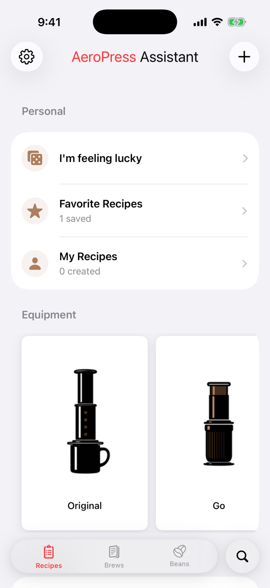
  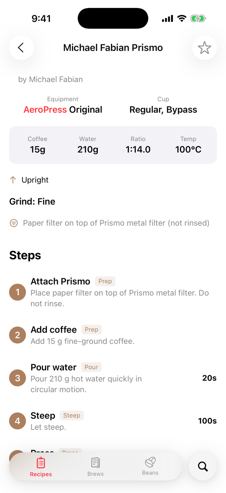
  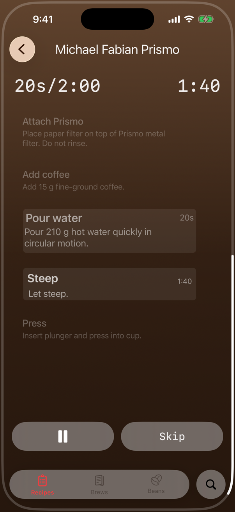
  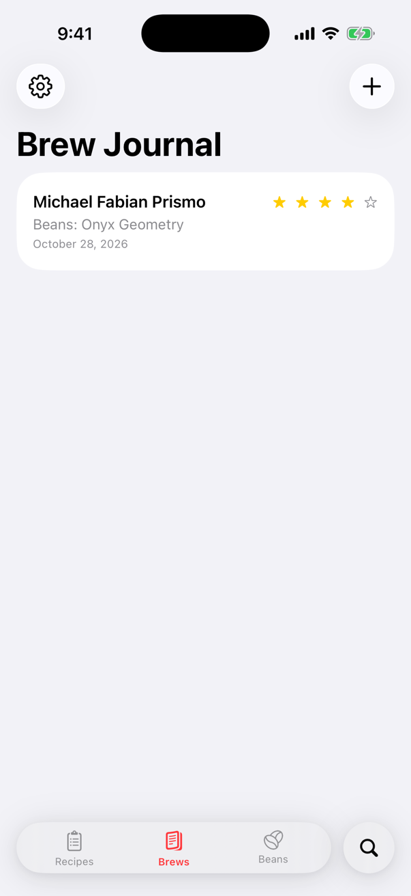

## Features

- **Recipe library** organized by equipment (Original, Go, XL), cup type (regular, espresso-style, iced, bypass, pour-over, cold brew) and accessories (Flow Control, Aesir, metal, linen and paper filters, MeloDrip)
- **Search and filter** by equipment, brew method, tags and accessories
- **Guided brewing**: a full-screen timer that walks through prep, pour, steep and press steps with per-step countdowns, skip and pause
- **Brew journal**: log a brew with recipe, beans, ratio, grind, brew time, a star rating and tasting notes
- **Beans journal**: track roaster, origin, roast level and process for each bag
- **Favorites, custom recipes and "I'm feeling lucky"** for a random recipe
- **Settings** for units, timer format, default ratio and temperature, preferred equipment, sounds and alerts

## More screenshots

  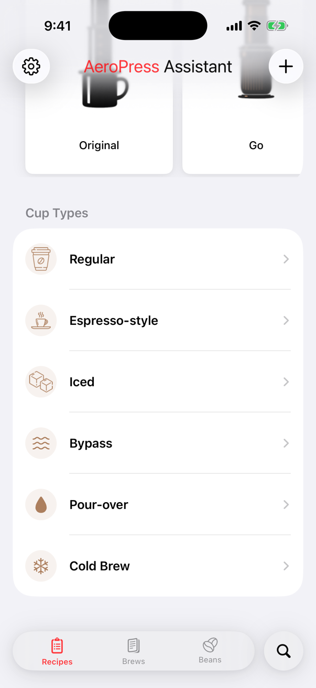
  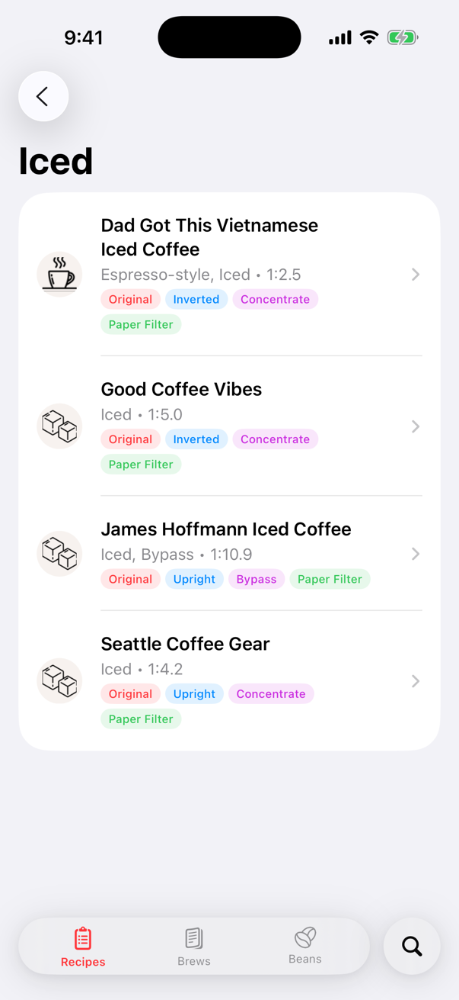
  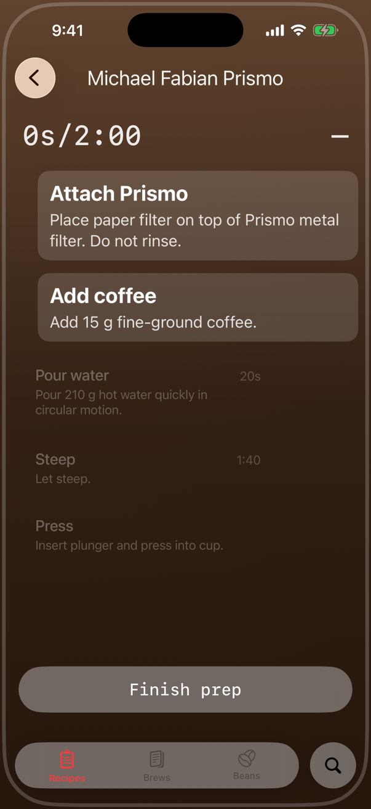
  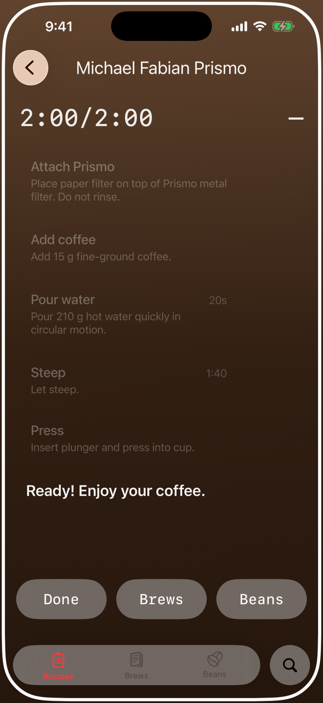
  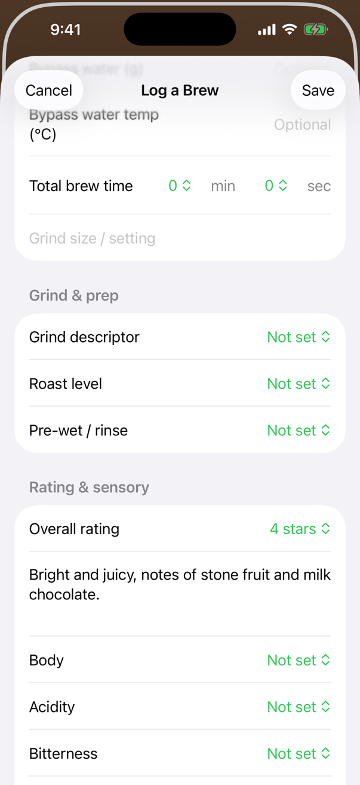
  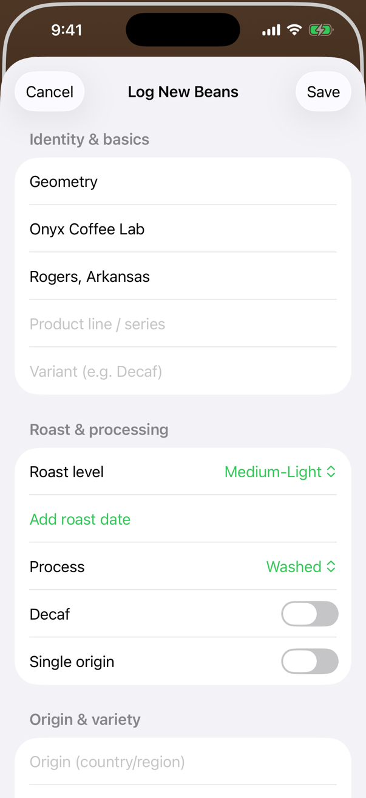
  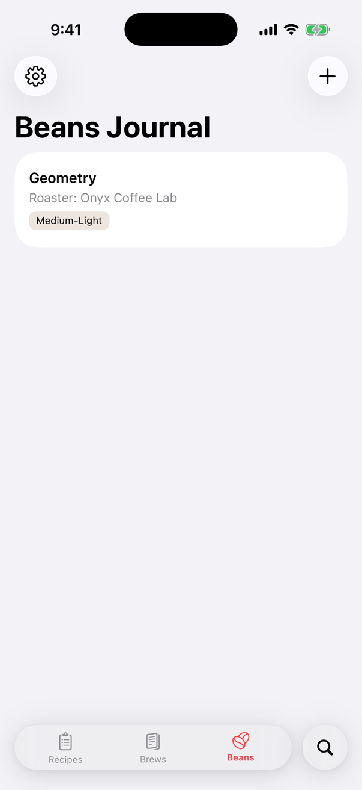
  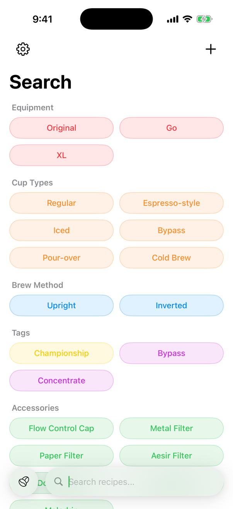
  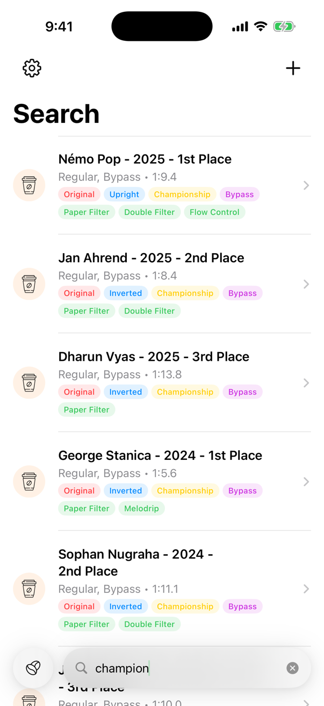

## Running it

This is a Swift Playgrounds app package (`.swiftpm`), targeting iOS 16+.

- **Swift Playgrounds** (iPad or Mac): open `coffee.swiftpm` and press Run.
- **Xcode**: open the `coffee.swiftpm` folder, choose an iPhone simulator, and run the `coffee` scheme.

## Built with

Swift 6, SwiftUI, AppStorage for settings, and UIKit haptics. Recipe data lives in `Data/` as Swift source.
